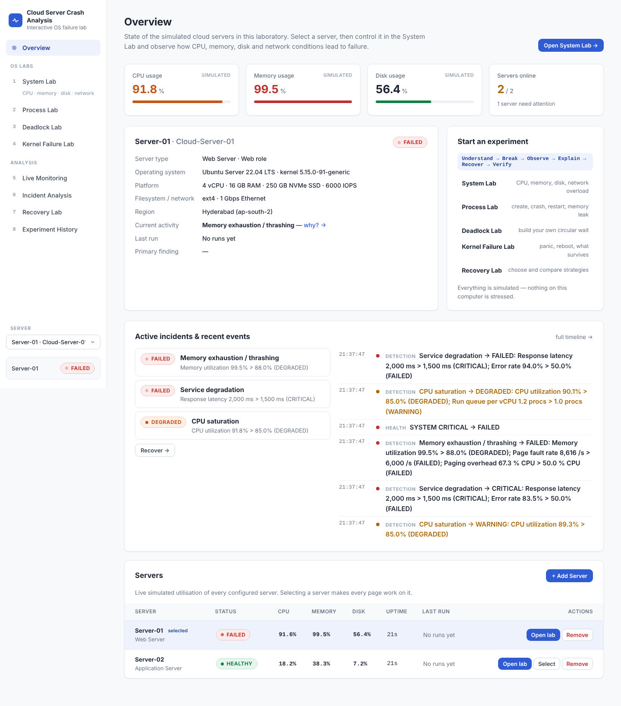

# Cloud Server Crash Analysis: An Operating System Perspective

An interactive web lab that simulates a cloud server's operating system, lets you push it into failures — CPU saturation, memory thrashing, disk bottlenecks, process crashes, deadlocks, kernel panics — and then **detects** the failure, **explains** its root cause, and **recovers** the server.


<!-- Screenshot: replace or add images in docs/screenshots/ -->

> **Everything is simulated.** The lab never stresses your computer — no CPU burn, memory allocation, disk writes, network shaping, signals or real locks. All metrics and findings below come from the simulation model.

---

## Overview

You control a virtual server — CPU workload, memory pressure, disk I/O, client traffic, network latency and loss, processes and locks — and watch every change propagate through CPU scheduling, paging, the I/O queue and TCP into latency, errors and failure.

```
USER CONTROL → SYSTEM STATE → OS BEHAVIOUR → METRICS → FAILURE → DETECTION → EXPLANATION → RECOVERY
```

## Failure types simulated (10)

| # | Failure | OS subsystem |
|---|---|---|
| 1 | CPU overload / saturation | CPU scheduling |
| 2 | Memory exhaustion & thrashing | Virtual memory / paging |
| 3 | Memory leak | Memory management |
| 4 | Disk I/O bottleneck (slow disk) | I/O management |
| 5 | Disk full (ENOSPC) | File system |
| 6 | Network degradation (latency, packet loss) | Networking / TCP |
| 7 | Critical process crash (SIGKILL / SIGSEGV) | Process management |
| 8 | Process hang | Process management |
| 9 | Process deadlock | Synchronization / resource allocation |
| 10 | Kernel panic (panic → reboot lifecycle) | Kernel |

Failures can also be combined (e.g. out-of-memory → panic, or everything at once) to study **cascading failures**.

## Metrics tracked

- **CPU:** utilization, run queue length, waiting time
- **Memory:** utilization, available memory, page-fault rate, paging overhead, swap I/O
- **Disk:** utilization, read/write IOPS, I/O queue length, latency, file-system space used
- **Network:** round-trip time, packet loss, retransmission delay, timeouts
- **Service:** request rate, response latency, error rate, throughput, availability
- **Processes & locks:** running / blocked / terminated processes, lock holders and waiters

Each value is tagged **SIMULATED**, **DERIVED** or **REAL**. *REAL* means read-only `psutil` readings of the host, used only when the optional host-anchored baseline is switched on.

## How it works

**Simulation.** A single model per virtual server updates every 0.5 s using standard OS relationships: queueing for the CPU run queue and the disk (M/M/c, M/M/1), a paging curve above ~80 % RAM, TCP retransmission with exponential back-off, a process table and a lock table.

**Detection.** Rule-based detectors watch only the observed metrics — never the controls. They grade health as HEALTHY → WARNING → DEGRADED → CRITICAL → FAILED, confirm each level over 2 consecutive samples, and use hysteresis to avoid alert flapping. Deadlocks are found with a wait-for-graph cycle search; Banker's algorithm and lock ordering are also included.

**Explanation.** Every value records how much each input contributed to it, so the lab can trace *why* a metric changed back to the control that caused it. Each failure episode records:
- the trigger
- the first threshold crossed
- the **primary** failure versus **secondary** (cascading) failures
- the causal chain

**Recovery.** Failure-specific strategies (reduce load, kill the hog, restart a crashed process, kill a deadlock victim, reboot after a panic) are applied, then verified by the same detector as **RECOVERED**, **PARTIAL** or **FAILED**. Experiments can be recorded and replayed exactly from a seed.

## Key findings (simulated)

All results come from the simulation model on the default server (4 vCPU, 16 GB RAM, NVMe), not from a real machine.

| Experiment | Result |
|---|---|
| CPU workload raised to 95 % | CPU 24 % → 100 %, run queue 0 → 129, response time 45 ms → 1,660 ms, error rate 0 % → 30 %; detected 1.0 s after the change, recovered 2.0 s after load was removed |
| Memory pressure at 55 % of RAM | memory 96 %, 5,400 page faults/s, 46 % of CPU time spent paging → thrashing (CRITICAL) |
| Alert hysteresis | with CPU held near its 75 % threshold for 5 simulated minutes, alerts fell from **62 alerts / 26 episodes to 1** |
| Disk-full recovery | stopping the log writer alone, or deleting its logs alone, both **FAILED**; stopping the writer *then* deleting the logs **RECOVERED** |

## Testing

**143 automated tests** (`unittest`), all passing. The 18 browser tests run only when Playwright is installed.

They cover network boundary conditions, memory thrashing, disk queueing, the process lifecycle, deadlock detection and recovery, the recovery state machine, the kernel-panic lifecycle, input validation and multi-server isolation.

```bash
python -m unittest discover -s tests -p "test_*.py" -v
```

## Tech stack

Python · Flask · SQLite · Chart.js · HTML/CSS/JavaScript · psutil · unittest · Playwright (browser tests)

## Run it

Requires Python 3.8+.

```bash
git clone https://github.com/Pramoda06/cloud-server-crash-analysis.git
cd cloud-server-crash-analysis
pip install -r requirements.txt
python app.py
```

Open **http://127.0.0.1:5000**. On Windows you can also double-click `run.bat`; it creates a virtual environment on first run.

## Documentation

- [Technical reference](docs/TECHNICAL_REFERENCE.md) — full control model, formulas, detection rules, recovery strategies
- [Lab guide](docs/LAB_GUIDE.md) · [Demo guide](docs/DEMO_GUIDE.md) · [Kernel lab](docs/KERNEL_LAB.md) · [Data sources](docs/DATA_SOURCES.md)

## Team

Built by **Challa Pramoda** ([@Pramoda06](https://github.com/Pramoda06)) and **Siri Reddy Tadi** as an Operating Systems case study (B.E. Information Technology, Chaitanya Bharathi Institute of Technology, Hyderabad).
